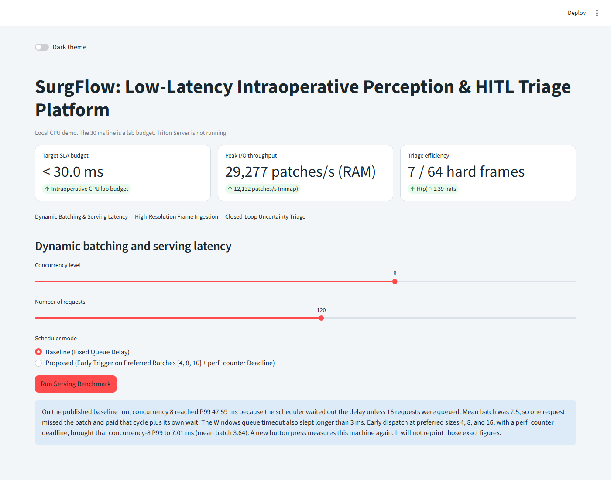
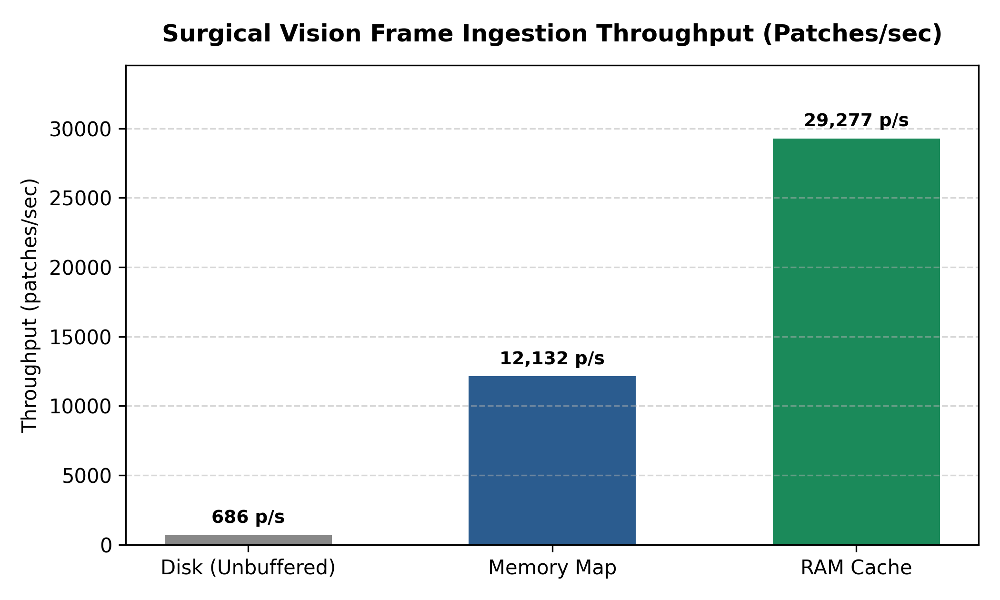
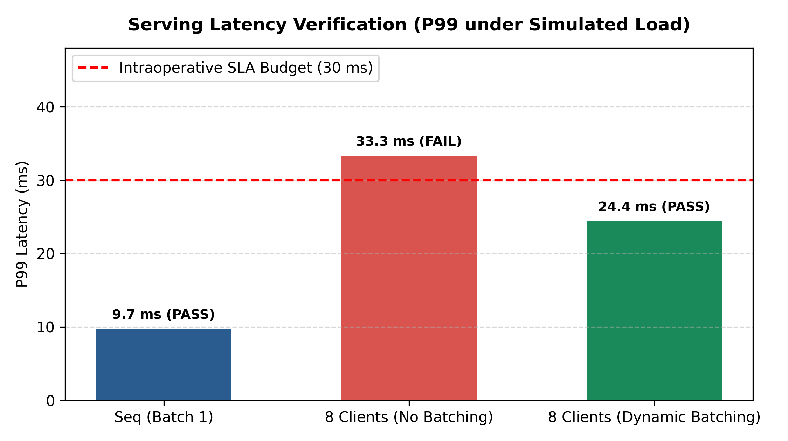

# surgical-vision-bench

Synthetic benchmark for three bottlenecks in a surgical-vision pipeline: patch streaming, model-serving latency, and uncertainty triage.

The suite builds an 8192×8192 RGB frame in memory, times how patches are read, profiles a small PyTorch network under a single-instance dynamic batcher, and ranks frames by predictive entropy. It reads no clinical images and does not start NVIDIA Triton, TensorRT, or a robot. Numbers in [BENCHMARK_RESULTS.md](BENCHMARK_RESULTS.md) are one CPU run of this pipeline check.

## Demo

`streamlit run app.py` opens a local board for the same three measurements. The 30 ms line on that page is the CPU lab budget.



## Benchmark Visualizations

| I/O Streaming Throughput | Dynamic Serving Latency (SLA Defense) |
| :---: | :---: |
|  |  |

Regenerate the figures with `python generate_plots.py` after a new benchmark run. The chart values are the rounded results in `BENCHMARK_RESULTS.md`.

## Tracks

| Track | Question | Primary metrics |
| --- | --- | --- |
| I/O | How fast can patches leave disk, a memory map, or RAM? | `throughput_patches_per_sec`, `io_latency_ms` |
| Serving | Does client P99 stay under 30 ms? | P50, P95, P99, `sla_met` |
| Closed loop | Which frames would a reviewer see first? | `triaged_ratio`, `avg_uncertainty_score` |

I/O compares unbuffered reads, memory-map slices, and in-RAM slices on a frame this process just wrote. The OS page cache may serve those reads.

Serving runs `TinySurgicalNet` (a small conv net) on one thread. Sequential mode is a batch-1 loop. Queued and dynamic-batch rows are client latency with one request in flight per worker. The SLA check is `p99_ms < 30`.

Closed-loop dispatch scores a labeled mix of peaked and near-uniform logits:

`H(p) = -sum_i p_i log(p_i)`

The top 10% go onto an in-process priority queue. Monte Carlo dropout on the untrained network is reported separately; those scores sit near the uniform ceiling because the network is not fit to a task.

## Setup

Python 3.10+ and the packages in `requirements.txt` (`numpy`, `torch`, and `matplotlib` for the charts). A CPU wheel is enough.

```bash
python -m pip install -r requirements.txt
python -m surgical_bench.runner --synthetic --output results/benchmark_report.json
```

`--synthetic` is required. The run writes `results/benchmark_report.json` and `BENCHMARK_RESULTS.md`.

`--strict` still writes both files, then exits 1 when any serving configuration misses the P99 budget.

Useful knobs: `--image-size` (8192), `--patch-size` (256), `--num-patches` (64), `--input-size` (128), `--num-requests` (64), `--frames` (64), `--mc-samples` (8), `--top-k` (0.10), `--sla-ms` (30), `--seed` (0).

## Layout

```
surgical_bench/
  io_pipeline/        patch streaming and the disk / memmap / RAM timings
  serving_pipeline/   TinySurgicalNet and the dynamic-batch client
  closed_loop/        entropy scoring and the clinician review queue
  runner.py           CLI for all three tracks
  report_generator.py JSON and Markdown writers
```
