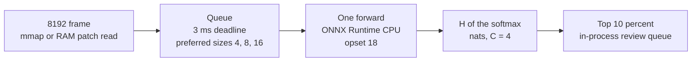

# Systems Engineering & Architecture Guide: Low-Latency Serving, High-Throughput I/O, and Closed-Loop Triage for Medical AI

Medical vision pipelines fail in production when three clocks are treated as one. Frame ingestion, model execution, and human review each have a different cost, and a 30 ms end-to-end budget has to be split across them on purpose.

This guide is the architecture behind two measured prototypes, not a deployment record. [surgical-vision-bench](https://github.com/higuseonhye/surgical-vision-bench) times patch reads, a single-instance PyTorch batcher, and entropy ranking on synthetic frames. [triton-serving-lab](https://github.com/higuseonhye/triton-serving-lab) times a Python queue with the same knobs as a Triton `config.pbtxt`: a 3 ms delay budget and preferred batch sizes 4, 8, and 16. NVIDIA Triton Server was not started. No GPU was used. The 30 ms line is a lab budget.

## Where each number comes from

| Question | Code | What the clock includes |
| --- | --- | --- |
| How fast can 256×256 patches leave an 8192×8192 frame? | `surgical_bench.io_pipeline` | Per-patch read plus copy into a `uint8` tensor. The frame was just written, so the OS page cache may serve it. |
| What is batch-1 ONNX Runtime time under thread contention? | `triton_client_bench.py` | `session.run` only. Queue wait is excluded. Batch size is 1. |
| What does a delay-only batcher do to end-to-end P99? | first `mock_dynamic_batcher.py` run | Enqueue to response event. The wait used `queue.get(timeout=…)`, which on this Windows host slept past 3 ms. |
| What changes when a preferred size dispatches early? | revised `mock_dynamic_batcher.py` | Same end-to-end clock. The deadline is `perf_counter`. |
| Which frames would a reviewer see first? | `surgical_bench.closed_loop` | Predictive entropy on a labeled logit mix, plus a separate Monte Carlo dropout score on an untrained network. |

## 1. Memory-mapped I/O for high-resolution frames

### 1.1 What `read` actually does

An 8192×8192 RGB frame is 8192 × 8192 × 3 = 201,326,592 bytes, about 192 MiB and 67.1 megapixels. That is a whole-slide-imaging *proxy*. A true gigapixel slide is an order of magnitude larger. The access pattern that matters here is smaller than the frame: a 256×256 patch is 196,608 bytes, and it is not contiguous in a row-major raster. Each of the 256 rows sits `width × channels` bytes apart.

`read` and `fread` copy bytes from the kernel page cache into a buffer the process owns. That is one copy even when the pages are already resident. A patch assembled row by row also pays a seek and a syscall per row. In this benchmark the disk path used unbuffered reads (`buffering=0`) and 256 seeks per patch. Context-switch cost is real, but on a warm file the dominant term is the number of small transfers, not a cold disk.

### 1.2 What `mmap` changes, and what it does not

`mmap` inserts the file's pages into the process page tables. A load or store to that address range is a memory access. If the page is resident, the kernel does not copy it into a second buffer. If it is not resident, the fault reads it from storage into the page cache and then the same virtual page is used. That is zero-copy only for consumers that read the mapping in place.

The measured memmap path does not do that. `PatchStreamer` materializes a contiguous array (`np.array(..., copy=True)`) and wraps it as a tensor, because a strided window is a poor model input. The copy remains. The win relative to the disk path is that the window is addressed as a slice instead of 256 seeks.

On the published CPU run, 64 patches of 256×256:

| Path | Patches/s | Mean latency | Versus disk |
| --- | ---: | ---: | ---: |
| Unbuffered row reads | 686.4 | 1.457 ms | 1× |
| Memory map, then a contiguous copy | 12,132 | 0.082 ms | 17.7× |
| Process-memory slice, then a contiguous copy | 29,277 | 0.034 ms | 42.7× |

Seventeen times is inside the range people quote for mmap versus small reads. It is not a portable 10×–40× law, and it is not a cold-disk result. RAM is faster than memmap here because the working set is already a dense allocation. Memmap still has page-table and fault-check overhead on first touch of each row.

### 1.3 Cache hierarchy, without inventing an ROI cache

A repeated read of the same tissue boundary is a working-set problem.

- L1 and L2 hold the lines the core touched last. A 256×256×3 patch is 192 KiB, which can reside in L2 on many client CPUs and will not reside in L1 (typically 32–64 KiB).
- L3 is the right place for a handful of hot patches shared by cores.
- DRAM holds the full 192 MiB frame. The RAM mode in the benchmark is this tier: one copy of the raster in the process, then per-patch packing.
- The page cache is the kernel's copy of the file. Memmap and `read` both hit it on a warm file. They differ in whether a second copy is made, and in how many syscalls build one patch.

An L1/L2 "tumor-boundary cache" is not implemented. The design consequence is straightforward. If a tracker revisits the same coordinates, keep the packed tensors in a small process-level map keyed by origin. That map should be sized to L2/L3, not to the whole slide. The frame itself stays in DRAM or on a mapping. Re-faulting the slide to redraw a boundary wastes the hierarchy the benchmark already measured: RAM at 0.034 ms mean versus memmap at 0.082 ms versus row reads at 1.457 ms.

## 2. Dynamic batching and queue scheduling

### 2.1 One model instance, many clients

Batch size 1 uses the device inefficiently once several clients are in flight, because a single execution thread finishes one request before the next starts. In the ONNX Runtime probe, the clock sat inside `session.run`, so queue wait was excluded and every call was one frame. P99 was 0.72, 3.54, 2.31, and 6.37 ms at concurrency 1, 4, 8, and 16. The engine itself was inside a 30 ms budget. That fact does not protect the client. The client's clock starts at enqueue.

A batcher that only waits for `max_batch_size` creates the opposite failure. With a cap of 16 and a 3 ms budget, concurrency 8 produced a mean batch of 7.5. One request missed the batch. Its end-to-end time was approximately

\[
L_{\text{tail}} \approx (w_1 + T(b_1)) + (w_2 + T(b_2))
\]

where \(w\) is queue wait and \(T(b)\) is the forward of a batch of size \(b\). On that run \(w\) was also inflated by the Windows timer: `queue.get(timeout=3ms)` often slept for a full tick. P99 at concurrency 8 was **47.59 ms**. Concurrency 16 filled toward the cap (mean batch 13.3) and dispatched sooner, with P99 13.94 ms. More clients were faster because they hit `max_batch_size` before the wait expired. That is queue behavior, not a faster model.

The PyTorch mock in `surgical-vision-bench` shows the same shape with a different model. Eight clients and `max_batch_size` 1 produced P99 33.3 ms. The same load with a max batch of 8 produced P99 24.4 ms. One configuration still missed 30 ms.

### 2.2 Early dispatch at a preferred size

Triton's dynamic batcher, and the mock that copies its knobs, has three controls:

- `max_batch_size` 16, the hard cap
- `max_queue_delay_microseconds` 3000, the time the first request may wait
- `preferred_batch_size` `[4, 8, 16]`, sizes that are allowed to leave early

The revised scheduler computes the available count as the in-hand batch plus anything already queued. It takes the largest preferred size that count can fill. If the in-hand batch has reached that size, it runs. It does not spend leftover budget hoping for a larger preferred size that has not arrived. If no preferred size is reachable, it waits until `now + 3.0 ms` measured with `perf_counter`, then runs whatever it has.

A request that finds a preferred size already forming waits for packing and one forward:

\[
L \approx t_{\text{collect}} + T(b), \qquad t_{\text{collect}} \ll 3\,\text{ms}
\]

A lone request never reaches 4, so it pays the budget:

\[
L \approx 3.0\,\text{ms} + T(1)
\]

That is the latency floor. On the revised run, concurrency 1 had P50 **3.45 ms** and P99 **3.97 ms**.

| Concurrency | Delay-only P99 | Early dispatch P99 | Early P50 | Mean batch |
| ---: | ---: | ---: | ---: | ---: |
| 1 | 16.81 ms | 3.97 ms | 3.45 ms | 1.00 |
| 4 | 16.94 ms | 5.89 ms | 1.48 ms | 3.64 |
| 8 | 47.59 ms | 7.01 ms | 2.77 ms | 3.64 |
| 16 | 13.94 ms | 9.20 ms | 4.98 ms | 5.22 |

Concurrency 8 moved from 47.59 ms to 7.01 ms, an 85.3% drop between these two runs. Both the early-dispatch rule and the `perf_counter` deadline changed. The drop is not the preferred-size rule alone. Mean batch 3.64 at concurrency 8 means the queue left when 4 requests were ready. Size 4 is preferred, so the scheduler did not wait for 8. The longest P99 in the revised table is 9.20 ms, at concurrency 16.

Preferred sizes of 4, 8, and 16 are the factors of `max_batch_size` 16. They are a scheduling choice: leave as soon as a useful batch exists. On an NVIDIA GPU, multiples of 8 also match Tensor Core tile sizes, which is why production configs often look like this. This lab did not run a GPU, and Tensor Core alignment did not produce the 7.01 ms result.

### 2.3 The budget has to be smaller than the SLA

Let the service objective be \(P99(L) < S\) with \(S = 30\,\text{ms}\). A single wait of length \(D\) is safe only if

\[
D + T(b) + t_{\text{transport}} < S
\]

for the batch sizes the scheduler actually emits, and only if a request is not charged for two waits. The straddle term \(2D + T(b_1) + T(b_2)\) is what broke concurrency 8 when \(D\) was both the configured 3 ms and a longer OS sleep.

Setting \(D = 3\,\text{ms}\) against \(S = 30\,\text{ms}\) leaves headroom for compute and, later, gRPC. It does not leave headroom for two full waits plus a 15 ms timer tick. Early dispatch cuts the chance of the second wait. It does not remove \(D\) for clients that arrive alone. Overnight batch scoring would invert the choice: a delay of seconds, a full batch, and a throughput goal. That setting was not measured here.

Throughput in requests per second was not recorded for the queue runs. A 500 req/s target belongs to a later `perf_analyzer` run. It is not a result of this lab.

## 3. Predictive entropy and review triage

### 3.1 A softmax peak is not a safety argument

The maximum class probability is high whenever the logit vector is peaked, including when the input is unlike anything the training set covered. Occlusion, smoke, and a domain shift can all move the input off the data manifold while the linear head still emits one large logit. A scalar "confidence" does not tell the queue which frames those are.

### 3.2 Shannon entropy of the predictive distribution

For a probability vector \(p\) over \(C\) classes, in nats,

\[
H(p) = -\sum_{i=1}^{C} p_i \ln p_i
\]

with the convention \(0 \ln 0 = 0\), implemented by clipping to a small epsilon before the log. \(H\) is zero for a one-hot vector and maximized for the uniform vector \(p_i = 1/C\):

\[
H(1/C, \ldots, 1/C) = \ln C
\]

For \(C = 4\), \(\ln 4 = 1.3863\) nats. An untrained four-way head on random inputs sits near that ceiling because its predictive distribution is nearly flat. Monte Carlo dropout on `TinySurgicalNet` (8 stochastic passes, 64 random inputs) averaged **1.3761 nats**, with range 1.3734–1.3782. That run does not separate easy frames from hard ones. It confirms the formula.

The dispatch experiment therefore used a labeled mix: 32 peaked logit rows and 32 near-uniform rows, 64 frames total. Entropy was 0.0517 nats on the peaked rows and 1.3854 nats on the near-uniform rows. Mean entropy was 0.7186 nats.

### 3.3 What top-10% review does, and what it does not

The queue keeps the \(k = \lceil 0.10 \cdot N \rceil\) highest scores. For \(N = 64\), \(k = 7\), so the dispatched fraction is \(7/64 = 0.1094\). All 7 were from the near-uniform group, in descending entropy order. Review volume is about one tenth of the frames. That arithmetic is not a measured 90% reduction in clinician cost, and it is not evidence that the other 90% are safe to skip. No labels were written back, and no retraining loop ran.

The production shape, if this ranking is later shown to track real errors, is ordinary active learning. The review queue is the set of frames worth labeling. Those labels can enter the next training set. Until that correlation is measured, the queue is a sort of an entropy score, not a safety policy.

## 4. End-to-end path

The boxes below are the intended dataflow. The solid measurements exist inside each box. The arrows between the I/O benchmark, the ONNX queue, and the entropy ranker were not timed as a single pipeline.

| Stage | Measured on this hardware | Not measured |
| --- | --- | --- |
| Patch read | 686 to 29,277 patches/s by path | A cold disk, a packed patch file, an ROI cache |
| Queue plus forward | P99 3.97–9.20 ms after early dispatch | Triton, gRPC, a GPU, a second instance |
| Entropy triage | 7 of 64 synthetic frames, all from the high-entropy class | Clinical safety of skipping the rest, retraining |

## 5. Scheduling rule in one paragraph

A 30 ms budget is spent in the queue, not in a 128×128 forward, once more than one client shares an instance. Waiting only for batch 16 charges unlucky requests for two cycles and, on this host, for a timer tick longer than 3 ms. Dispatching the largest preferred size already queued, and closing the wait with a monotonic clock, kept P99 at or below 9.20 ms for concurrency 1 through 16 in the local ONNX Runtime queue. Single clients still pay about 3.5 ms, which is the delay budget. Review ranking by \(\ln C\) entropy selects the flat predictions. It does not, by itself, justify leaving the other frames unlabeled.
